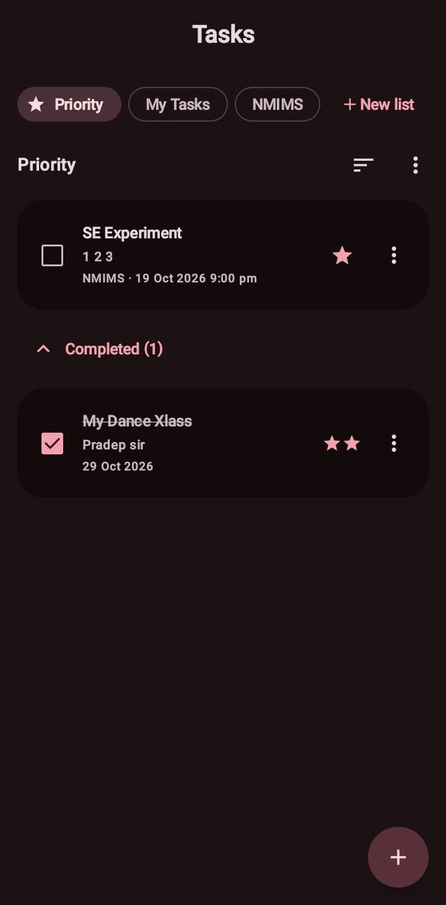
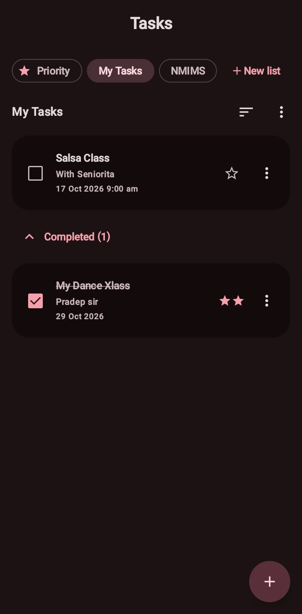
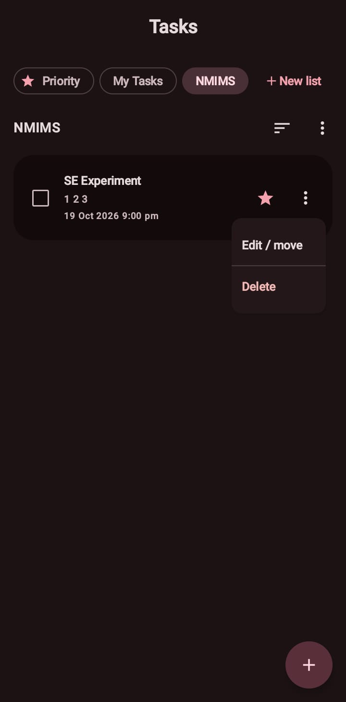
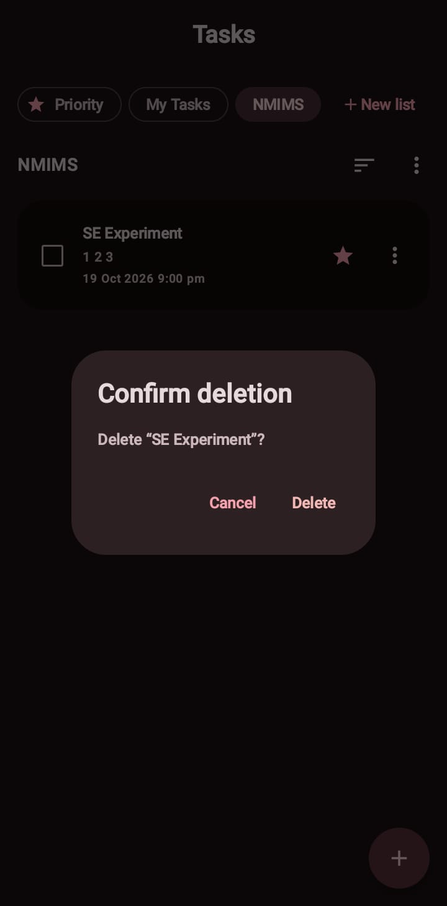
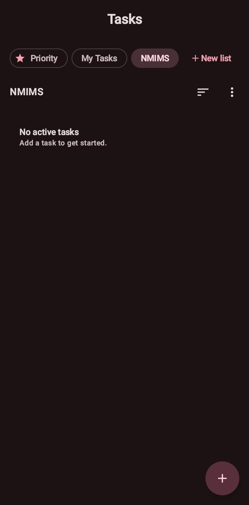
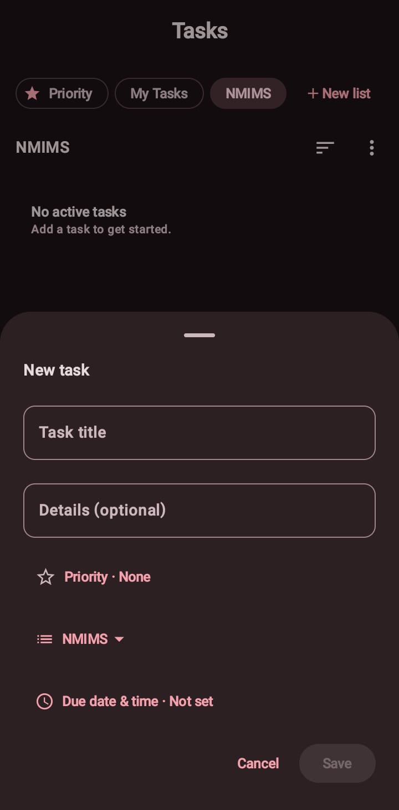
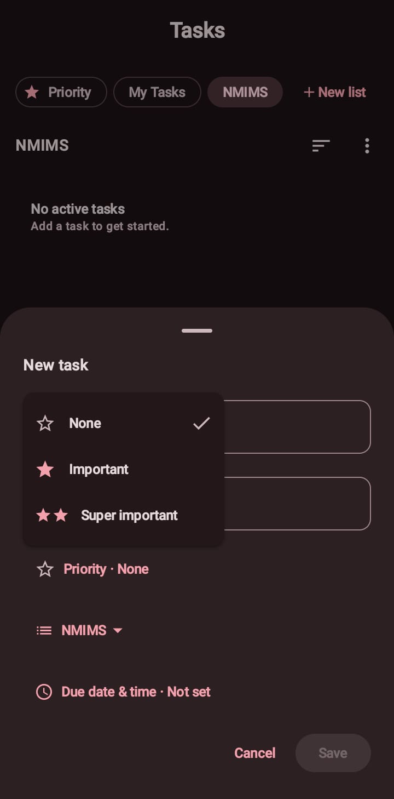
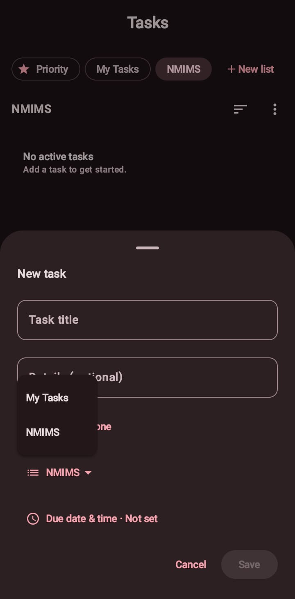
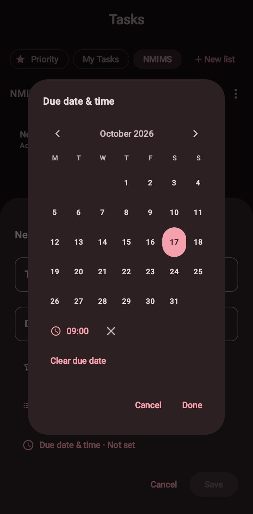

# Personal Tasks

A native Android task manager built with Kotlin, Jetpack Compose, Material 3, and Firebase Realtime Database. It is a hands-on example of connecting a Compose UI to a live Firebase data source: user actions write small updates, and Firebase listeners drive the displayed state.

## Screenshots

All screenshots are in [`assets/`](assets/). They use short, descriptive filenames so they can also be linked directly from GitHub.

| Priority view and completed item | My Tasks and completed section |
|---|---|
|  |  |

| Custom-list task actions | Delete confirmation |
|---|---|
|  |  |

| Empty custom list | New-task composer |
|---|---|
|  |  |

| Three-level priority picker | Task destination list picker |
|---|---|
|  |  |

| Priority tab across lists |
|---|
|  |

## Features

- **Lists:** Built-in, non-deletable My Tasks list and independently managed custom lists. Create, rename, select, and delete custom lists. Deleting a list also deletes its tasks after confirmation.
- **Tasks:** Create, edit, move between lists, complete, restore, and delete. Task title is required; description is optional. Deletes require confirmation.
- **Priority:** Choose **None**, **★ Important**, or **★★ Super important** from an explicit menu. Priority tab combines Important and Super important tasks across lists, ordered with the two-star level first. Older Boolean priority values remain readable (`true` maps to Important).
- **Completed tasks:** Completed records remain stored and can be restored. Each list has a collapsible completed section with a live count.
- **Sorting:** Sort by due date, most recently created, or title.
- **Due dates:** Optional local date and time selection, Monday-first calendar, month navigation, and clear-date action. Dates are stored in Firebase; the picker does not use Google Calendar.
- **Realtime/offline behavior:** Firebase listeners refresh Compose state after changes. Firebase disk persistence is enabled, connectivity and errors are surfaced in the UI, and composer saves remain open until Firebase confirms success.
- **Material design:** Always-dark Material 3 theme with a warm brown/pink palette, rounded cards/sheets, and generous spacing.

There are no repeat schedules, task duplication, manual reordering, list archiving, or local notification reminders in the current feature set.

## Tech stack

- Kotlin and Android SDK
- Jetpack Compose UI and Material 3 components
- Firebase Realtime Database Android SDK
- Gradle Kotlin DSL and version catalog

## Firebase data model

The app connects to `https://assignment2-be688-default-rtdb.firebaseio.com` and stores app data under a generated installation ID:

```text
devices/
  {deviceId}/
    lists/
      my_tasks/
        name: "My Tasks"
        isDefault: true
        createdAt: 1792230000000
      {listId}/
        name: "College"
        isDefault: false
        createdAt: 1792230000000
    tasks/
      {taskId}/
        listId: "my_tasks"
        title: "Prepare assignment"
        description: "Review the report"
        completed: false
        priority: 2
        dueAt: 1792316400000
        hasTime: true
        dueTimezone: "Asia/Kolkata"
        createdAt: 1792230000000
        updatedAt: 1792230000000
```

`priority` values are `0` (None), `1` (Important), and `2` (Super important). `dueAt` is Unix epoch milliseconds and is absent when no due date is set. `dueTimezone` is an IANA timezone identifier used with the timestamp. Optional values written as `null` are removed by Realtime Database.

### Device identity and access

On first launch, the app generates a random UUID and stores it in Android SharedPreferences. The ID is excluded from Android backup and device transfer; clearing app data or reinstalling creates a new ID. Data remains isolated by path in the database, for example `devices/abc.../tasks`.

The app intentionally has **no Firebase Authentication**. A client-generated ID is a namespace, not proof of identity; it does not secure a user's data from other database clients. Realtime Database rules must allow the app's no-auth reads and writes, so this setup is appropriate for a learning project—not secure multi-user production access. The Firebase client configuration is in [`app/google-services.json`](app/google-services.json).

Existing records under the former root `/tasks` path and old local task preferences are not deleted or migrated automatically. Previous repeat/archive/order fields are ignored by the current app; archived lists from the former UI now appear normally. Tasks previously created as recurrence occurrences remain ordinary tasks.

## How the Firebase flow works

The main implementation is in [`TaskStore.kt`](app/src/main/java/com/yashd/assignment2/TaskStore.kt) and [`MainActivity.kt`](app/src/main/java/com/yashd/assignment2/MainActivity.kt):

1. `TaskStore` creates a `DatabaseReference` rooted at `devices/{deviceId}` and enables local Firebase persistence.
2. `start()` attaches `ValueEventListener`s to the device's `lists`, `tasks`, and Firebase's `.info/connected` node.
3. Each `onDataChange` converts a `DataSnapshot` to Kotlin `TaskList`/`PersonalTask` values and updates observable Compose state. Firebase invokes the listeners for the initial value and subsequent local or remote changes.
4. New records use `push().key` for collision-resistant IDs. Edits retain their existing ID.
5. `updateChildren()` writes targeted paths, such as a single task's `completed` or `priority` field, rather than replacing unrelated records. The completion callback lets forms report a failed save; listeners reconcile the displayed data.
6. `stop()` removes listeners when the Compose screen leaves composition.

This makes the app useful for exploring snapshots, listeners, references, push IDs, multi-location updates, server timestamps, offline persistence, and Compose state.

## Project map

```text
app/src/main/java/com/yashd/assignment2/
  MainActivity.kt       Main screen, list selection, task rows and actions
  TaskStore.kt          Firebase models, listeners, references and writes
  TaskComposer.kt       Task editor and local date/time picker
  PriorityButton.kt     Three-level priority control
  Priority.kt           Priority decoding and labels
  ui/theme/Theme.kt     Material 3 warm dark color scheme and shapes
  ui/theme/Type.kt      Material typography

assets/
  priority-list-completed-tasks.jpeg
  my-tasks-completed.jpeg
  custom-list-task-actions.jpeg
  delete-task-confirmation.jpeg
  custom-list-empty-state.jpeg
  task-composer.jpeg
  priority-level-selector.jpeg
  task-list-selector.jpeg
  priority-view.jpeg
```

## Build

Requirements: Android Studio-compatible Android SDK, JDK, and the included Gradle wrapper.

```sh
./gradlew :app:assembleDebug
```

The debug APK is produced at `app/build/outputs/apk/debug/app-debug.apk`.
